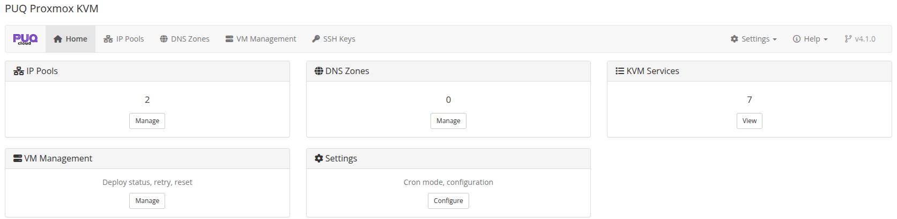

# Dashboard

### Proxmox KVM module **[WHMCS](https://puqcloud.com/link.php?id=77)**
#####  [Order now](https://puqcloud.com/whmcs-module-proxmox-kvm.php) | [Download](https://download.puqcloud.com/WHMCS/servers/PUQ_WHMCS-Proxmox-KVM/) | [Community](https://community.puqcloud.com/)

The addon module dashboard provides a quick overview of all managed resources.

*addon-dashboard-home.png*

## Dashboard Cards

| Card | Description |
|------|-------------|
| **IP Pools** | Total number of configured IP address pools |
| **DNS Zones** | Total number of configured DNS zones |
| **KVM Services** | Total number of active KVM services |
| **VM Management** | Link to the centralized VM management page |
| **Settings** | Link to the module settings |

## Navigation

The top navigation bar provides access to all addon sections:

- **Home** — Dashboard overview with quick stats and companion appliances
- **IP Pools** — IPv4/IPv6 address pool management
- **DNS Zones** — DNS zone configuration (Cloudflare, HestiaCP, PowerDNS)
- **VM Management** — Centralized VM monitoring, deployment logs, and manual state actions
- **SSH Keys** — Global client SSH public keys management
- **Settings** — General settings, timeouts, bulk queue, and cron configuration
- **Help** — Direct links to module documentation, companion Docker tools (PVE-OS-Builder, VNC Web Proxy), and official support
