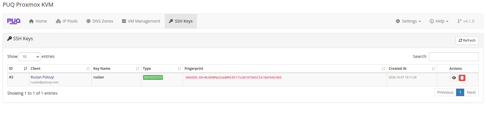

# SSH Keys Management

### Proxmox KVM module **[WHMCS](https://puqcloud.com/link.php?id=77)**
#####  [Order now](https://puqcloud.com/whmcs-module-proxmox-kvm.php) | [Download](https://download.puqcloud.com/WHMCS/servers/PUQ_WHMCS-Proxmox-KVM/) | [Community](https://community.puqcloud.com/)

The **SSH Keys** page in the addon module provides administrators with a centralized overview of all client-managed OpenSSH public keys stored in the WHMCS database.

---

## Overview

Navigate to **Addons → PUQ Proxmox KVM → SSH Keys**.

*addon-ssh-keys-list.png*

From this view, administrators can monitor, search, inspect, and manage SSH public keys uploaded by clients across all accounts.

### Table Columns

| Column | Description |
|---|---|
| **ID** | Unique internal database ID of the SSH key record |
| **Client** | Client name and email address with direct link to their WHMCS client profile |
| **Key Name** | Nickname or label assigned to the key by the client |
| **Type** | Key algorithm badge (`SSH-ED25519`, `SSH-RSA`, `ECDSA-SHA2-*`) |
| **Fingerprint** | Cryptographic SHA256 fingerprint of the public key |
| **Created At** | Date and time when the key was added |
| **Actions** | Quick action buttons: **View Key** (eye icon) and **Delete** (trash icon) |

---

## Features

- **Instant Search & Filtering:** Filter keys by client name, email address, key label, algorithm, or fingerprint.
- **View Public Key:** Click the **View** button to inspect the full OpenSSH public key text and copy it if needed.
- **Key Deletion:** Remove outdated or invalid keys directly from the administrative panel.
- **Secure by Design:** Only standard OpenSSH public keys (`ssh-ed25519`, `ssh-rsa`, `ecdsa-sha2-*`) are stored in the database. Private keys are never accepted or processed.
- **Automatic Cloud-Init Integration:** Stored keys are made available to the client during service checkout (`cart.php`) and operating system reinstallation in the Client Area.

---

## Client Area Controls

To configure whether clients can access the SSH Key Manager or customize where navigation links appear in the Client Area, navigate to:

**Addons → PUQ Proxmox KVM → Settings → General → Client Area SSH Keys**

See the [General Settings documentation](05-settings.md#client-area-ssh-keys) for details.
