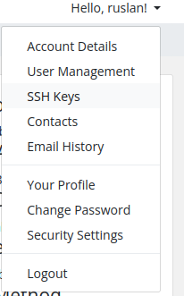
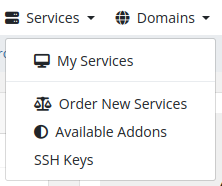
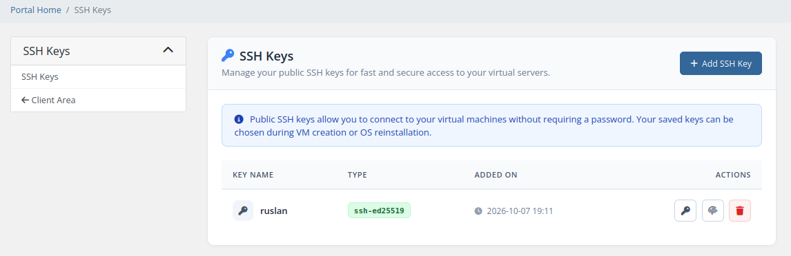
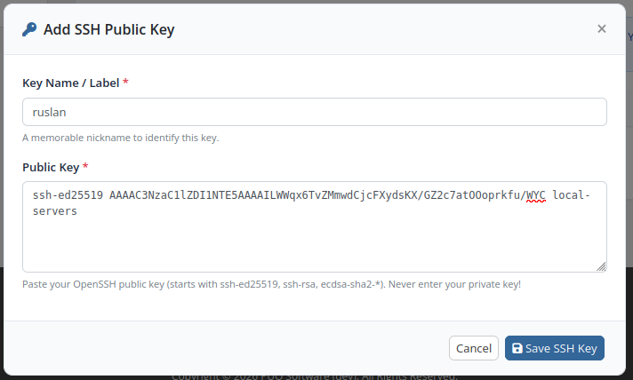
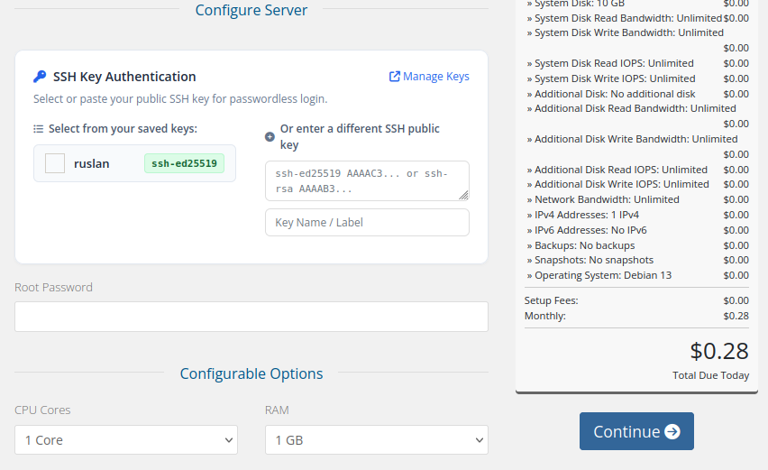
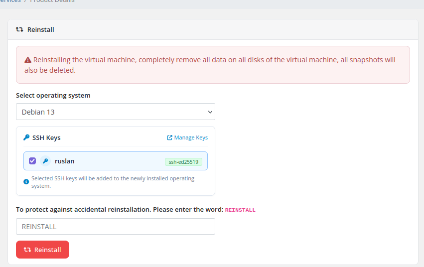

# SSH Keys

### Proxmox KVM module **[WHMCS](https://puqcloud.com/link.php?id=77)**
#####  [Order now](https://puqcloud.com/whmcs-module-proxmox-kvm.php) | [Download](https://download.puqcloud.com/WHMCS/servers/PUQ_WHMCS-Proxmox-KVM/) | [Community](https://community.puqcloud.com/)

The **SSH Keys** management feature enables clients to securely manage their OpenSSH public keys in their WHMCS account profile. Stored keys can be selected during new VM orders and operating system reinstallations for automatic, passwordless Cloud-Init provisioning.

---

## Accessing the SSH Key Manager

Clients can access their saved SSH keys through multiple convenient entry points:

### 1. User Profile Menu
Click the account dropdown menu in the upper-right corner (**Hello, {Name}!**) and select **SSH Keys**.

*client-area-user-menu-ssh-keys.png*

### 2. Services Navigation Menu
Click **Services** in the main navigation bar and choose **SSH Keys**.

*client-area-services-menu-ssh-keys.png*

---

## Managing Saved Keys

The SSH Keys overview page displays all authorized public keys associated with the client's account.

*client-area-ssh-keys-manage.png*

### Key List Table

| Column | Description |
|---|---|
| **Key Name** | A memorable nickname chosen by the user to identify their workstation or device |
| **Type** | The cryptographic key algorithm badge (e.g., `ssh-ed25519`, `ssh-rsa`, `ecdsa-sha2-*`) |
| **Added On** | Timestamp when the key was created |
| **Actions** | Quick interactive actions: **Copy Public Key**, **Copy Fingerprint (SHA256)**, and **Delete** |

### Interactive Actions
- **Copy Public Key** (key icon): Instantly copies the full OpenSSH public key text to the clipboard.
- **Copy Fingerprint** (fingerprint icon): Copies the SHA256 cryptographic fingerprint to the clipboard.
- **Delete** (trash icon): Opens a confirmation modal to remove the key from saved keys. Deleting a key does not revoke it from already provisioned virtual machines.

---

## Adding an SSH Public Key

Click the **+ Add SSH Key** button to open the key registration modal.

*client-area-ssh-key-add-modal.png*

1. **Key Name / Label:** Enter a nickname for the key (e.g., `work-laptop`, `id_ed25519`).
2. **Public Key:** Paste the OpenSSH public key. Supported formats:
   - `ssh-ed25519` (recommended for modern security and performance)
   - `ssh-rsa`
   - `ecdsa-sha2-nistp256`, `ecdsa-sha2-nistp384`, `ecdsa-sha2-nistp521`
3. Click **Save SSH Key**.

> **Security Note:** Never enter private keys (`id_rsa`, `id_ed25519`). Only public keys (`.pub`) are accepted. The module automatically validates the public key structure and derives the SHA256 fingerprint.

---

## SSH Key Authentication During Service Orders

When purchasing a new virtual machine (`cart.php?a=confproduct`), clients can choose their authentication method on the **Configure Server** page.

*client-order-ssh-key-selection.png*

### Selection Options
- **Select from saved keys:** Check the boxes for any saved SSH keys you want to inject into the VM.
- **Enter a different SSH public key:** Paste a new OpenSSH public key on-the-fly without leaving the order funnel.

### Automatic Password Handling
- **When one or more SSH keys are selected or entered:** The standard **Root Password** field is automatically hidden. The module generates a secure 30-character random password in the background, ensuring strict passwordless SSH access.
- **When no SSH keys are selected:** The **Root Password** field is displayed normally, allowing standard password-based login.

---

## SSH Keys During OS Reinstallation

Clients can also assign SSH keys when performing an operating system reinstall on an active virtual machine:

*client-area-reinstall.png*

1. Navigate to the service details and open **Reinstall**.
2. Select the operating system.
3. Check the desired **SSH Keys** from your saved keys.
4. Type `REINSTALL` in capital letters and confirm.
5. Cloud-Init deploys the new OS image with the selected public keys pre-authorized in `/root/.ssh/authorized_keys`.
